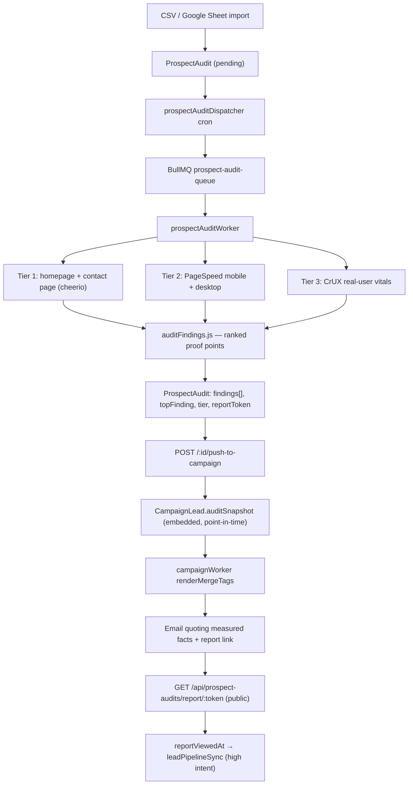

# Prospect Audit → Personalised Outreach — Implementation Plan

> **⚠️ PLAN ONLY — none of this is built yet.** Written 2026-10-15 against commit `92130e1`.
> What exists today: the Tier 1 crawler + PageSpeed call in `backend/src/workers/prospectAuditWorker.js`,
> scoring in `backend/src/utils/prospectScoring.js`, and a campaign sender that knows nothing about any
> of it. Everything below is proposed work. Keep this warning until each phase actually ships.

**Goal:** use detailed per-site audit findings to write cold emails that quote real, measured facts
about the prospect's own website, and raise reply/conversion rate.

---

## 1. Why the crawler is not the bottleneck

Three things were verified in the current code before writing this plan. Each one blocks the goal
regardless of how deep the crawler gets.

### 1.1 Tiering discards the best prospects

`calculateProspectScores` was run against realistic profiles:

| Prospect profile | technical | opportunity | tier today |
|---|---|---|---|
| Established, 50 reviews, **runs Meta ads**, mobile 32/100 | 25 | **100** | **`skip`** |
| Same prospect, PageSpeed call failed | 0 | 100 | `skip` |
| Wix site, no analytics, no ads, slow | 44 | 40 | `medium` |
| Neglected: no SSL, not mobile-friendly | 72 | 15 | `low` |

`prospectScoring.js:79` decides the tier from `technicalScore` **first** — under 30 is `skip`, whatever
the opportunity score says. A site with the basics right (SSL, viewport, title, a known CMS, analytics)
can only pass 30 by being fundamentally broken, so a business actively spending on ads with a slow site
is labelled `skip` and additionally flagged `technically_sound`. The lowest-value prospect in the table
outranks the highest-value one.

### 1.2 PageSpeed data is missing, and its absence reads as "no problem"

`prospectAuditWorker.js:66` defines one `FETCH_TIMEOUT_MS = 10000` and reuses it for the PageSpeed
call at line 224. PageSpeed runs a real Lighthouse pass server-side and normally takes longer than
10s, so the call aborts. Both audits recorded in `backend/logs/prospect-audit.log` failed this way:

```
PSI failed for https://bizzbuzzcreations.com/: This operation was aborted
Audited bizzbuzzcreations — tier=skip technical=10 opportunity=70
```

Two consequences. The most persuasive data (real load numbers) is never collected, and because the
error is swallowed at line 279 while `psiPerformanceScore` stays `null`, every PageSpeed scoring branch
is skipped — so a missing measurement is scored identically to a perfect one. Nothing in the UI shows
the data is absent.

### 1.3 No audit finding can reach an email

There is no connection between the two subsystems:

- `ProspectAudit` holds ~28 findings per site. Nothing outside the audit files reads them.
- Campaign CSV import accepts 7 columns only (`campaignController.js:376`): email, first/last name,
  phone, business name, type, city.
- Merge tags are `{{first_name}}`, `{{last_name}}`, `{{email}}`, `{{redirect_url}}`,
  `{{response_options}}` (`campaignWorker.js:106`).

The only path from audit to campaign is CSV export + re-import, which drops every finding. Tripling
crawler depth today would not change one word of any sent email.

---

## 2. Target architecture



The decisive piece is `auditFindings.js`: it converts raw measurements into ranked, human-readable
sentences. Everything downstream consumes sentences, not raw fields, so the email templates stay
simple and no template author has to interpret a score.

---

## 3. Phase 1 — make existing data usable

Nothing in Phase 2 pays off until this lands. Phase 1 alone should already improve conversion,
because it stops excluding the best prospects and starts quoting real numbers.

### 3.1 Fix the PageSpeed call — `workers/prospectAuditWorker.js`

- Split the timeouts: keep `FETCH_TIMEOUT_MS = 10000` for page fetches, add
  `PSI_TIMEOUT_MS = 60000` and give `runTier2` its own `fetchWithTimeout(url, opts, PSI_TIMEOUT_MS)`.
- Retry the PageSpeed call twice with backoff before giving up; it is independently flaky.
- Record the outcome instead of swallowing it: `psiStatus: 'ok' | 'failed' | 'skipped'`, plus
  `psiError`. A failed PageSpeed run must never be scored as a healthy site (see 3.2).
- Fix the mislabelled metric at line 247: `inp` currently stores the `interactive` audit, which is
  Time to Interactive. Store `tti` separately and populate `inp` from
  `experimental-interaction-to-next-paint`, leaving it `null` when absent.
- Run `strategy=mobile` and `strategy=desktop` **in parallel** (`Promise.all`), since the gap between
  them is itself a strong pitch.
- Pull two free extras already present in the PageSpeed response: `total-byte-weight` →
  `pageWeightKb`, and `render-blocking-resources` → `renderBlockingCount`.

### 3.2 Recalibrate tiering — `utils/prospectScoring.js`

Replace the single `technicalScore < 30 → skip` gate with a two-axis decision, and never skip a
prospect that shows spending signals:

```
no_site   crawl failed
unknown   psiStatus !== 'ok'            → incomplete data, queue a re-crawl, never skip
hot       opportunity >= 50 && need >= 20   ← ads + fixable problems
high      opportunity >= 50 && need >= 10
medium    opportunity >= 25 && need >= 15
low       need >= 10
skip      need < 10 && opportunity < 50     ← genuinely nothing to pitch, no budget signal
```

Also remove the contradiction where a site can carry `slow_load`, `technically_sound` and
`high_opportunity` at once: `technically_sound` should require `need < 10` **and** no severity-4+
finding.

Add a `hot` value to the `tier` enum in `models/ProspectAudit.js:82` and to the tier filters in
`src/pages/ProspectAuditDetailPage.jsx`.

### 3.3 New file — `utils/auditFindings.js`

The core of personalisation. A catalogue of findings, each with a stable code, a severity, a
`pitchValue` (how compelling in a cold email), an `applies()` predicate and a `sentence()` built only
from measured values. Ranked by `pitchValue × severity`, top N kept.

```js
{
  code: 'ads_to_slow_site',
  severity: 5,
  pitchValue: 10,
  applies: (a) => a.hasAdsPixel && a.psiPerformanceScore != null && a.psiPerformanceScore < 50,
  title: 'Paid ads pointing at a slow page',
  sentence: (a) =>
    `You're running paid ads to a homepage Google scores ${a.psiPerformanceScore}/100 on mobile — `
    + `most of that click spend leaves before the page finishes loading.`,
}
```

Starting catalogue (highest pitch value first):

| code | fires when | why it sells |
|---|---|---|
| `ads_to_slow_site` | ads pixel + mobile perf < 50 | wasted ad spend, quantified |
| `noindex` | `hasNoindexTag` | invisible in Google today |
| `no_ssl` | `!hasSSL` | every visitor sees "Not secure" |
| `ads_without_analytics` | ads pixel, no analytics | paying for clicks they cannot measure |
| `mobile_desktop_gap` | desktop − mobile ≥ 25 | concrete, surprising, easy to verify |
| `slow_lcp` | LCP > 4s | "takes {lcp}s to show anything on a phone" |
| `no_local_schema` | local business, no `LocalBusiness` in `structuredDataTypes` | hurts Maps/local ranking |
| `heavy_page` | `pageWeightKb` > 3000 | "{mb}MB homepage, ~{x}× typical" |
| `missing_meta` | no title or no meta description | what Google prints in results |
| `no_contact_form` | `!hasContactForm` | enquiries lost outright |
| `images_no_alt` | > 5 images, alt ratio < 0.3 | SEO + accessibility |
| `no_sitemap` | no sitemap and no robots.txt | crawlability |

Each sentence is written once by a human with placeholders for measured numbers only, so no claim can
ever exceed the data. That is the whole reason for choosing deterministic templates over generated
prose: one wrong statement about someone's own website ends the conversation.

### 3.4 Schema additions — `models/ProspectAudit.js`

```js
// Findings (output of auditFindings.js)
findings: [{ code: String, severity: Number, title: String, sentence: String }],
topFinding:   { type: String, default: '' },   // denormalised for fast merge-tag use

// Data quality
psiStatus:    { type: String, enum: ['pending','ok','failed','skipped'], default: 'pending' },
psiError:     { type: String, default: '' },
needsRecrawl: { type: Boolean, default: false },

// New measurements
psiPerformanceScoreDesktop: { type: Number, default: null },
pageWeightKb:        { type: Number, default: null },
renderBlockingCount: { type: Number, default: null },
httpStatus:          { type: Number, default: null },
tti:                 { type: Number, default: null },
cruxLcp:             { type: Number, default: null },   // real-user field data
cruxInp:             { type: Number, default: null },
cruxCls:             { type: Number, default: null },

// Hosted report
reportToken:     { type: String, index: true, default: () => crypto.randomBytes(16).toString('hex') },
reportViewedAt:  { type: Date, default: null },
reportViewCount: { type: Number, default: 0 },
```

### 3.5 The bridge — `POST /api/prospect-audits/:id/push-to-campaign`

New handler in `controllers/prospectAuditController.js`, route in `routes/index.js` inside the
existing `prospectAuditsRouter` (already gated by `authorizeFeature('prospect_audit', …)`).

Body: `{ campaignId, tiers: ['hot','high'], onlyWithEmail: true, minOpportunity }`.

It selects matching prospects in the batch and creates `CampaignLead`s carrying an **embedded**
snapshot:

```js
auditSnapshot: {
  prospectId, auditedAt, reportToken,
  tier, technicalScore, opportunityScore,
  perfMobile, perfDesktop, seoScore, lcpSeconds, pageWeightKb,
  topFinding,
  findings: [{ code, sentence }],   // capped at 5
}
```

Embedded rather than a populated reference, for two reasons. Sending must not depend on a join at
send time, and the audit is a point-in-time claim — if the prospect fixes their site next week, the
email that already went out should still reflect what was actually measured. Same reasoning as the
write-once attribution blocks on `Lead`.

The email dedupe, validation and MX-verification logic in `campaignController.importLeads`
(`campaignController.js:445-470`) should be **extracted into a shared helper** and called from both
paths, not copied.

### 3.6 Merge tags — `workers/campaignWorker.js`

Extend `renderMergeTags` (line 106) to read `lead.auditSnapshot`:

| tag | resolves to |
|---|---|
| `{{top_finding}}` | highest-ranked finding sentence |
| `{{finding_2}}`, `{{finding_3}}` | next ranked sentences |
| `{{findings_list}}` | `<ul>` of the top N |
| `{{perf_score}}` / `{{perf_desktop}}` | mobile / desktop PageSpeed score |
| `{{lcp_seconds}}` | LCP, 1 decimal |
| `{{page_weight_mb}}` | page weight in MB |
| `{{seo_score}}` | PageSpeed SEO score |
| `{{audit_report_url}}` | public report link for this prospect |
| `{{city}}` / `{{business_type}}` | already on the lead, trivially useful |

Two safety requirements, both absent from the current implementation:

1. **Escape every substituted value.** Current merge tags interpolate raw lead fields into HTML.
   Audit sentences contain measured values and titles pulled from the prospect's own page, so the
   new tags must be HTML-escaped. Worth fixing the existing tags in the same pass.
2. **Never send a half-rendered email.** If a campaign body references an audit tag and a lead has no
   `auditSnapshot`, the email must not go out saying "takes undefined seconds". Add a readiness check
   in `utils/campaignReadiness.js` that detects audit tags in the body and refuses to start a campaign
   whose pending leads lack snapshots, plus a per-lead guard in the dispatcher that marks such a lead
   `failed` with a clear reason instead of sending.

### 3.7 Hosted report page

- `GET /api/prospect-audits/report/:token` — public, no auth, identity from the unguessable token.
  Must be mounted **before** the protected `prospectAuditsRouter`, the same ordering rule that
  `campaignPublic` and the social OAuth callback already follow (see the comments at
  `routes/index.js:223` and `:418`).
- Renders a self-contained HTML page in the style of `trackingController.js`'s `PAGE()` helper:
  the scores, the ranked findings with short explanations, and one CTA that reuses the existing
  `track/call-request/:token` route so a request from the report lands in the pipeline exactly like
  today's call requests.
- Records `reportViewedAt` / `reportViewCount` and calls `leadPipelineSync` — a report view is a
  stronger intent signal than an open.
- **Reuse the scanner suppression already written** in `trackingController.js:51-53` (user-agent +
  under-15s heuristic). Without it, Microsoft Safe Links and similar prefetchers will manufacture
  "prospect viewed their report" signals. The CTA itself must be a POST, not a GET, for the same
  reason the unsubscribe flow is split into confirm-then-POST.

---

## 4. Phase 2 — crawler depth that earns a reply

Each addition must map to a sentence a prospect would react to; anything that does not is just
storage. All are in `workers/prospectAuditWorker.js` unless noted.

- **Contact page, not just the homepage.** Follow the first `/contact`-ish internal link, fetch it,
  and check for a working form, a `mailto:`, and a phone number. "Your contact page has no working
  enquiry form" is money left on the table and currently invisible.
- **CrUX real-user vitals.** `chromeuxreport.googleapis.com/v1/records:queryRecord` with the same
  API key. Field data from real visitors is far more credible than a lab score and sidesteps the
  "your test is wrong" objection.
- **Local SEO signals.** Does the page text contain the imported `phone` and `cityLocation`
  (name/address/phone consistency)? Is there `LocalBusiness` schema? These matter most for the
  Maps-scraped lists being imported.
- **Social presence.** Links to Instagram/Facebook/LinkedIn. "No Instagram linked anywhere on your
  site" is a concrete pitch for a local business.
- **Tech staleness.** jQuery version, `document.write`, Flash remnants — easy signals of a site
  nobody has touched in years.
- **Open Graph tags.** No `og:image` means broken previews whenever anyone shares their link.
- **Record `httpStatus` and honour it** (see 5.1).

---

## 5. Prerequisite fixes

These are not polish. Each one can produce a *false* claim in an email, and a wrong statement about
someone's own website is worse than sending nothing.

1. **`runTier1` never checks `res.ok`** (`prospectAuditWorker.js:114`). A 403, 404 or 500 page is
   parsed and scored as the real site, producing findings like "no title tag" about an error page.
   Must check status, store it, and treat non-2xx as a crawl failure. This also makes the `blocked`
   status reachable — today it can only come from a regex on an exception message (line 298).
2. **No response size cap** on `res.text()`. One large page can exhaust worker memory.
3. **SSRF.** The crawler fetches any imported URL with `redirect: 'follow'` and the new report page
   will echo crawled content (title, meta description) back over HTTP. Block private and
   link-local IP ranges after DNS resolution, and cap redirects.
4. **Stuck prospects.** A prospect left in `crawling` after a worker crash is never reset, so
   `autoCompleteFinishedBatches` never completes the batch. Add a stale-claim sweep.
5. **The dedupe index probably does not exist.** `ProspectAudit.js:91` uses
   `partialFilterExpression: { email: { $ne: '' } }`; MongoDB partial indexes do not support `$ne`,
   so index creation fails and duplicates are possible — meaning the same business can be emailed
   twice. Use `{ email: { $gt: '' } }` or a sparse index and verify with `getIndexes()`.

---

## 6. Throughput

Current pacing: the dispatcher releases 50 prospects/minute (`prospectAuditDispatcher.js:29`), worker
concurrency is 5, PageSpeed allows 25,000 requests/day/key with two keys configured.

Phase 1 makes 3 API calls per prospect (PageSpeed mobile + desktop + CrUX):

- **API budget:** 25,000 ÷ 3 ≈ 8,300 prospects/day/key, so ~16,600/day with both keys. Far above
  current list sizes — not the constraint.
- **Worker capacity is the real constraint.** At ~20s per PageSpeed call run in parallel plus the
  page fetches, a prospect takes ~25s. Concurrency 5 gives ~12 prospects/minute, well under the
  dispatcher's 50/minute — the queue would grow indefinitely. Raise worker concurrency to ~20
  (≈48/min, matching the dispatcher) and keep the parallel mobile/desktop calls.
- The in-memory daily counter (`dailyCounts`) assumes a single API process; it stays correct only
  while the backend is not clustered.

---

## 7. Deliberately out of scope

- **Generated prose.** Decided against for the factual claims; a wrong statement destroys
  credibility. Could be revisited later for greeting/closing tone only, over verified sentences.
- **Headless-browser auditing (Playwright).** Already a deferred Tier 3 in the worker's own header
  comment. PageSpeed + CrUX cover the same ground without running a browser farm.
- **Screenshots in the report.** Appealing, but needs a browser; revisit with Tier 3.
- **Competitor comparison.** High pitch value ("your competitor loads in 1.2s, you take 8.4s") but
  needs a reliable competitor source per prospect. Worth a follow-up once Phase 1 data is trusted.

---

## 8. Suggested order

1. §5 prerequisite fixes (1-3 especially) — stop bad data entering the system.
2. §3.1 PageSpeed fix + §3.2 tiering — the right prospects become visible.
3. §3.3 findings catalogue + §3.4 schema — sentences start existing.
4. §3.5 bridge + §3.6 merge tags — findings reach an email. **First point of real conversion impact.**
5. §3.7 hosted report — stronger CTA and an intent signal.
6. §4 depth — more and better findings, now that each one has somewhere to go.
